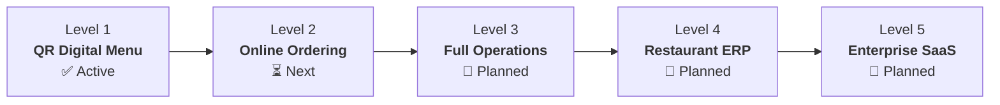

# 🍽️ Restaurant Management SaaS Platform

A modern, multi-tenant cloud platform built for restaurants, cafes, and bars in Ethiopia and beyond. Designed to streamline daily operations across digital QR menus, online ordering, Kitchen Display Systems (KDS), Waiter/POS terminals, inventory ERP, and subscription billing.

- **Initial Flagship Tenant:** ፍሬ ባር እና ሬስቶራንት (Fre Bar & Restaurant)
- **Primary Currency:** Ethiopian Birr (`ETB`)
- **Languages:** Native English & Amharic (`አማርኛ`)
- **Architecture:** Multi-Tenant Shared Database with strict tenant isolation

---

## 📖 Complete Documentation Hub

Detailed technical design documents are maintained under [`/docs`](./docs/README.md):

| Documentation Guide | Overview |
|---|---|
| [**Software Requirements Specification (SRS)**](./docs/SRS.md) | Master 22-section requirements specification, business rules, and technical standards. |
| [**Technical Architecture**](./docs/ARCHITECTURE.md) | High-level architecture, directory layout, real-time messaging, and multi-tenancy model. |
| [**Database Schema & Models**](./docs/DATABASE_SCHEMA.md) | Entity relationship diagrams, active models, extended L2–L5 schemas, and indexes. |
| [**REST API Specification**](./docs/API_SPECIFICATION.md) | Comprehensive API endpoint reference, payloads, and error codes. |
| [**Development Roadmap**](./docs/ROADMAP.md) | 5-level milestone delivery tracker and acceptance criteria. |

---

## ⚡ Tech Stack

- **Frontend & Backend:** [Next.js 14](https://nextjs.org/) (App Router, React Server Components, Server Actions, Route Handlers)
- **Language:** [TypeScript](https://www.typescriptlang.org/) (Strict type-checking)
- **Styling:** [Tailwind CSS](https://tailwindcss.com/)
- **Database & ORM:** [PostgreSQL](https://www.postgresql.org/) managed on [Supabase](https://supabase.com/) with [Prisma ORM](https://www.prisma.io/)
- **QR Generation:** [`qrcode`](https://www.npmjs.com/package/qrcode) for dynamic, downloadable high-res vector/PNG QR codes
- **Hosting & CI/CD:** [Vercel](https://vercel.com/)

---

## 🏗️ Phased Development Levels



1. **Level 1 — QR Digital Menu *(Completed MVP)***: Responsive public menu, Amharic/English toggle, category filtering, QR code generation, owner product/category dashboard, and page-view analytics.
2. **Level 2 — Interactive Ordering**: Digital shopping cart, table QR validation, server-side price calculation, and live order tracking.
3. **Level 3 — Complete Operations**: Kitchen Display System (KDS), Waiter ordering, Point of Sale (POS), Cashier shifts, and role-based permissions.
4. **Level 4 — Restaurant ERP**: Inventory management, recipe Bill of Materials (BOM), automated stock deduction, supplier purchase orders, and profit reporting.
5. **Level 5 — Enterprise SaaS**: Multi-branch restaurant groups, Super Admin management, automated tiered subscriptions, and payment gateways (Telebirr, CBE Birr).

---

## 🚀 Getting Started

### 1. Prerequisites
- **Node.js:** v18.18.0 or higher
- **Package Manager:** `npm` (or `pnpm`/`yarn`)
- **Database:** PostgreSQL instance (Supabase or local Postgres)

### 2. Environment Configuration
Copy `.env.example` to `.env` (or configure your `.env`):
```bash
cp .env.example .env
```

Ensure `DATABASE_URL` is configured:
```env
DATABASE_URL="postgresql://postgres:[PASSWORD]@[HOST]:[PORT]/postgres?pgbouncer=true"
```

### 3. Install Dependencies & Initialize Database
```bash
# Install packages
npm install

# Push database schema to PostgreSQL
npm run db:push

# Seed demo data (Fre Bar & Restaurant + categories + items + demo owner)
npm run db:seed
```

### 4. Start Development Server
```bash
npm run dev
```

The application will be live at:
- **Public Menu (English):** [http://localhost:3000/menu/fre-bar](http://localhost:3000/menu/fre-bar)
- **Public Menu (Amharic):** [http://localhost:3000/menu/fre-bar?lang=am](http://localhost:3000/menu/fre-bar?lang=am)
- **Admin Dashboard:** [http://localhost:3000/dashboard](http://localhost:3000/dashboard)

---

## 🔒 Security & Multi-Tenancy Design

- **Strict Tenant Boundary:** Every tenant-owned database record contains a `restaurantId`.
- **Server-Side Validation:** All prices and order totals are calculated on the server; client-submitted prices are ignored.
- **Tenancy Guard:** Protected mutations and queries pass through `requireRestaurantAccess()` to guarantee users cannot view or manipulate data from other restaurants.
- **Audit Logging:** Destructive updates, role changes, and inventory adjustments maintain auditable history.

---

## 📄 License
Private & Proprietary. All rights reserved.
