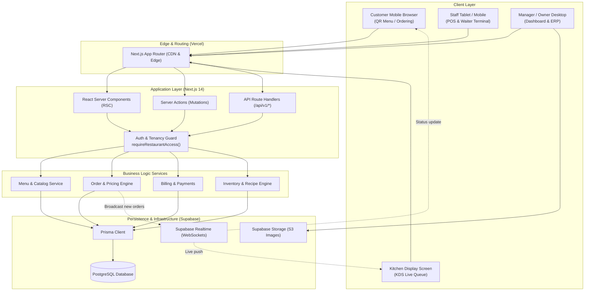

# Technical Architecture & Multi-Tenancy Design

This document details the architectural principles, component structure, security boundaries, and multi-tenant isolation patterns implemented in the Restaurant Management SaaS Platform.

---

## 1. Multi-Tenant Strategy

### 1.1 Shared Database, Shared Schema Model
The platform adopts a **Tenant-Partitioned Shared Database** approach:
- **Operational Efficiency:** Single database pool to monitor, backup, and upgrade across all restaurants.
- **Tenant Isolation:** Data belonging to different restaurants is strictly partitioned using `restaurantId` (UUID) foreign keys indexed across all primary tables.
- **Hierarchical Tenancy:**
  ```
  Platform
    └── Restaurant (Tenant)
          ├── Memberships (Users + Roles)
          ├── Categories & Products (Catalog)
          └── Branches (Locations)
                ├── Tables (with unique QR tokens)
                ├── Orders & Order Items
                ├── Cashier Sessions & Payments
                └── Inventory & Stock Movements
  ```

### 1.2 Tenant Resolution & Authorization Guard
1. **Public Routes (`/menu/[slug]`):**
   - Tenant is identified via unique restaurant `slug`.
   - The query returns only publicly safe, active menu items (`isActive = true`, `isAvailable = true`).
   - Sensitive financial and internal notes are omitted from public serialization.
2. **Dashboard & Private API Routes (`/dashboard/*`, `/api/v1/*`):**
   - The user session is verified via Supabase Auth.
   - The user's active membership is verified against the target `restaurantId`.
   - The user's role (`OWNER`, `MANAGER`, `WAITER`, `KITCHEN`, `CASHIER`) is verified against the endpoint's permission requirements.

---

## 2. System Architecture & Component Interaction



---

## 3. Directory Layout (Next.js App Router)

```
restaurant-saas/
├── docs/                             # Full architectural & technical documentation
│   ├── SRS.md                        # Master Software Requirements Specification
│   ├── ARCHITECTURE.md               # Technical architecture & multi-tenancy
│   ├── DATABASE_SCHEMA.md            # Schema, ERD & query designs
│   ├── API_SPECIFICATION.md          # REST API endpoints & contracts
│   └── ROADMAP.md                    # 5-Level roadmap & milestones
├── prisma/
│   ├── schema.prisma                 # Prisma schema definition
│   └── seed.ts                       # Database seeder (Fre Bar & initial admin)
├── public/                           # Static assets
├── src/
│   ├── app/
│   │   ├── globals.css               # Global Tailwind CSS definitions
│   │   ├── layout.tsx                # Master root layout
│   │   ├── page.tsx                  # Landing / root redirection page
│   │   ├── dashboard/                # Protected restaurant admin portal
│   │   │   ├── actions.ts            # Server Actions (Mutations)
│   │   │   ├── layout.tsx            # Dashboard sidebar & top navigation
│   │   │   ├── page.tsx              # Analytics overview & quick stats
│   │   │   ├── categories/page.tsx   # Menu category management
│   │   │   ├── products/page.tsx     # Menu item catalog management
│   │   │   ├── qr-codes/page.tsx     # QR generation & PNG export
│   │   │   └── settings/page.tsx     # Restaurant profile & branding settings
│   │   └── menu/
│   │       └── [slug]/               # Public customer-facing QR menu
│   │           ├── page.tsx          # Restaurant menu home (English / Amharic)
│   │           └── category/[id]/    # Filtered category item listing
│   ├── components/
│   │   ├── Menu.tsx                  # Customer-facing menu component
│   │   └── ui.tsx                    # Shared UI primitives (buttons, badges, modals)
│   └── lib/
│       ├── i18n.ts                   # English / Amharic translation dictionary
│       ├── prisma.ts                 # Singleton Prisma client instance
│       └── auth/
│           ├── require-restaurant-access.ts # Tenancy & role verification helper
│           └── session.ts            # User session & identity provider
├── .env.example                      # Template environment variables
├── package.json                      # Dependencies and npm scripts
├── tailwind.config.ts                # Tailwind design configuration
└── tsconfig.json                     # TypeScript compiler configuration
```

---

## 4. Real-Time Communication Pattern

For Kitchen Display System (KDS) order streaming, waiter alert pings, and customer status updates:

1. **Transactional Order Ingestion:** The order is committed first via `prisma.$transaction`.
2. **Outbox / Realtime Event Notification:** Once the transaction commits, an event payload is sent via Supabase Realtime Channel or PostgreSQL WAL replication:
   ```json
   {
     "event": "ORDER_CREATED",
     "restaurantId": "550e8400-e29b-41d4-a716-446655440000",
     "branchId": "771e8400-e29b-41d4-a716-446655440001",
     "orderId": "992e8400-e29b-41d4-a716-446655440002",
     "timestamp": "2026-11-08T14:30:00Z"
   }
   ```
3. **Authorized Re-Fetch:** Client devices receiving the ping re-fetch authoritative data through authorized Route Handlers or Server Actions to guarantee tenant isolation and security.

---

## 5. Bilingual Architecture (English & Amharic)

The platform natively supports Amharic (`አማርኛ`) alongside English:
- Menu Category: `name` (English), `nameAm` (Amharic)
- Product: `name`, `nameAm`, `description`, `descriptionAm`
- UI strings are mapped in `src/lib/i18n.ts`:
  ```typescript
  export type Language = "en" | "am";
  export const translations = {
    en: { menu: "Menu", categories: "Categories", price: "Price", ... },
    am: { menu: "ሜኑ", categories: "ምድቦች", price: "ዋጋ", ... },
  };
  ```
- Public menu queries capture customer language choice (`lang=am` query parameter) to increment localized view analytics (`MenuView`).

