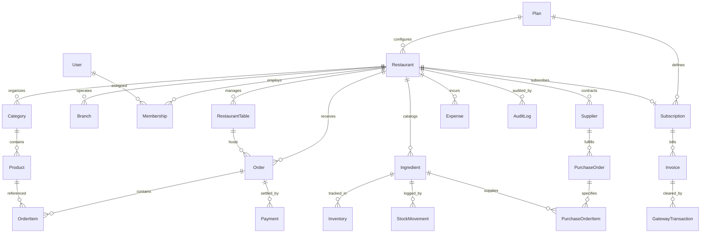

# Database Schema & Data Models Specification

This document provides a comprehensive reference of all data models, relationship structures, indexing strategies, and enums across all 5 operational levels of the Restaurant SaaS platform.

---

## 1. Database Principles

1. **Strict Multi-Tenancy:** Every operational record carries a foreign key `restaurantId UUID NOT NULL` indexed for instant tenant-scoped query execution.
2. **UUID Primary Keys:** All tables use `@id @default(uuid()) @db.Uuid`.
3. **High-Precision Decimals:** Financial numbers (prices, totals, costs) use `Decimal(12, 2)`, while inventory quantities use `Decimal(12, 4)`.
4. **Historical Snapshots:** Order and invoice line items record product and ingredient prices at the exact time of order placement.

---

## 2. Global Entity Relationship Diagram (Levels 1–5)

---

## 3. Core Models by Level

### Level 1 & 2: Menu, Catalog & Customer Ordering
- **`Restaurant`**: Tenant definition with bilingual names (`name`, `nameAm`), slug, branding, contact info.
- **`Category`**: Catalog organization with Amharic support and display sort orders.
- **`Product`**: Menu items with pricing in ETB, availability toggles, and photo references.
- **`RestaurantTable`**: Dine-in physical tables paired with unique QR tokens (`tbl-fre-20`).
- **`Order`**: Master order record (`DINE_IN`, `TAKEAWAY`, `DELIVERY`) progressing from `PENDING` to `COMPLETED`.
- **`OrderItem`**: Line item recording product snapshot, quantity, and preparation notes.
- **`MenuView`**: Analytics counter tracking menu view events and language preferences.

### Level 3: Restaurant Operations
- **`Payment`**: Multi-channel payment records (`CASH`, `TELEBIRR`, `BANK_TRANSFER`, `CARD`) with transaction IDs.
- **`Membership`**: User role assignments (`OWNER`, `MANAGER`, `WAITER`, `KITCHEN`, `CASHIER`).

### Level 4: Restaurant ERP
- **`Ingredient`**: Raw ingredient catalog with unit types (`kg`, `g`, `L`, `pcs`), cost per unit, and min stock thresholds.
- **`Inventory`**: Branch-level stock ledger maintaining current quantity on hand.
- **`StockMovement`**: Immutable ledger recording stock increases, recipe consumption, adjustments, and waste.
- **`Supplier`**: Vendor profiles, contact details, and procurement history.
- **`PurchaseOrder` & `PurchaseOrderItem`**: Goods procurement workflow (`DRAFT` ➔ `ORDERED` ➔ `RECEIVED`). Receiving an order automatically updates `Inventory` atomically.
- **`Expense`**: Operating overhead tracking across `RENT`, `UTILITIES`, `PAYROLL`, `SUPPLIES`, `MARKETING`, and `OTHER`.

### Level 5: Enterprise SaaS & Super Admin
- **`Plan`**: SaaS subscription tiers (`BASIC`, `STANDARD`, `PREMIUM`, `ENTERPRISE`) with feature gates (`hasKDS`, `hasPOS`, `hasERP`, `hasAPI`).
- **`Subscription`**: Active billing cycle and trial status per restaurant.
- **`Invoice`**: Periodic billing invoices.
- **`GatewayTransaction`**: Direct transaction logs for Ethiopian payment gateways (**Telebirr**, **Chapa**, **CBE Birr**).
- **`Branch`**: Multi-location modeling for restaurant chains with HQ flags.
- **`AuditLog`**: Platform-wide chronological security and administrative event stream.
- **`AdminUser`**: Platform super-administrators separate from restaurant tenants.
